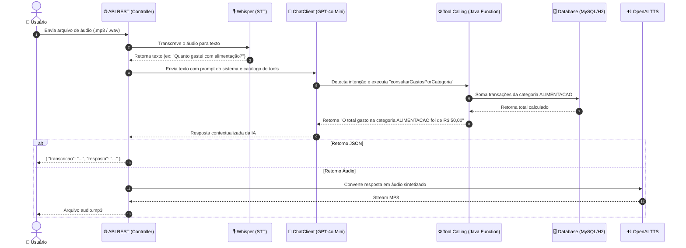

# 🎙️ Assistente Financeiro Inteligente com Spring AI

Projeto desenvolvido como solução do Desafio de Projeto da **Digital Innovation One (DIO)** na trilha de Spring Boot e Inteligência Artificial.

---

## 📌 1. O Que o Projeto Faz

A aplicação é uma **API REST inteligente de gestão e controle de orçamentos pessoais**. Ela combina processamento de áudio, inteligência artificial generativa e persistência relacional com Domain-Driven Design (DDD).

### 🔄 Fluxo de Processamento da Solução:


---

## ⚙️ 2. Tecnologias Utilizadas

- **Java 17+ / Java 21+**: Linguagem base com Records, Pattern Matching e convenções modernas.
- **Spring Boot 3.x / 4.x**: Framework central para injeção de dependências e API REST.
- **Spring AI (2.0.0-M4)**: 
  - `ChatClient`: Comunicação fluente com LLM.
  - `TranscriptionModel` (Whisper): Speech-to-Text.
  - `TextToSpeechModel` (TTS): Text-to-Speech.
  - `Tool / Function Calling`: Mapeamento automático de chamadas Java pelo modelo de IA.
- **Spring Data JPA & Hibernate**: Camada de persistência relacional.
- **MySQL & Docker Compose**: Banco de dados relacional conteinerizado.
- **Lombok**: Redução de boilerplate em entidades e modelos.
- **JUnit 5, AssertJ & Mockito**: Testes automatizados unitários e de integração.
- **Gradle Wrapper**: Build e gerenciamento de dependências.

---

## 🚀 3. Qual Melhoria Foi Implementada

> **Consulta por Categoria via Tool Calling (`consultarGastosPorCategoria`)**  
> Foi criada uma ferramenta inteligente que permite ao usuário consultar seus gastos totais diretamente por voz ou texto (ex: *"Quanto gastei em alimentação?"* ou *"Qual o valor total de transporte?"*).

### 🧩 Detalhamento dos Componentes Criados:

1. **DTO de Entrada da Função (`ConsultaCategoriaRequest`)**:
   ```java
   public record ConsultaCategoriaRequest(
       @JsonPropertyDescription("A categoria da transação para busca, ex: ALIMENTACAO, TRANSPORTE, LAZER, GROCERIES, PHARMA, AUTO")
       String categoria
   ) {}
   ```
2. **Serviço de Domínio/Aplicação (`TransactionService`)**:
   Implementa a regra de negócio para buscar as transações por categoria e totalizar os valores com precisão monetária (`BigDecimal`):
   ```java
   public BigDecimal calcularTotalPorCategoria(String categoria) {
       Category category = Category.fromString(categoria);
       long totalAmount = transactionRepository.findAllByCategory(category)
               .stream()
               .mapToLong(Transaction::getAmount)
               .sum();
       return BigDecimal.valueOf(totalAmount).setScale(2, RoundingMode.HALF_UP);
   }
   ```
3. **Configuração da Tool no Spring AI (`FinancialToolsConfig`)**:
   Expõe o bean `Function<ConsultaCategoriaRequest, String>` anotado com `@Description`:
   ```java
   @Configuration
   public class FinancialToolsConfig {
       @Bean
       @Description("Busca o valor total de despesas cadastradas para uma categoria específica")
       public Function<ConsultaCategoriaRequest, String> consultarGastosPorCategoria(TransactionService service) {
           return request -> {
               BigDecimal total = service.calcularTotalPorCategoria(request.categoria());
               return String.format("O total gasto na categoria %s foi de R$ %.2f", request.categoria(), total);
           };
       }
   }
   ```
4. **Registro no `ChatClient` (`TransactionController`)**:
   A função foi registrada com `.functions("consultarGastosPorCategoria")` no `ChatClient`, permitindo ao modelo invocá-la dinamicamente conforme a intenção do usuário.

---

## 🛠️ 4. Como Executar a Aplicação

### Passo 1: Clonar ou abrir o projeto
```bash
git clone https://github.com/SEU-USUARIO/dio-spring-boot-learning-track.git
cd dio-spring-boot-learning-track/05-spring-ai
```

### Passo 2: Configurar a chave de API da OpenAI
Defina a variável de ambiente `OPENAI_API_KEY`:

- **Windows (PowerShell):**
  ```powershell
  $env:OPENAI_API_KEY="sua-chave-openai-aqui"
  ```
- **Windows (CMD):**
  ```cmd
  set OPENAI_API_KEY="sua-chave-openai-aqui"
  ```
- **Linux / macOS:**
  ```bash
  export OPENAI_API_KEY="sua-chave-openai-aqui"
  ```

### Passo 3: Subir o banco de dados via Docker Compose
```bash
docker compose up -d
```

### Passo 4: Executar a aplicação
- **Windows:**
  ```cmd
  .\gradlew.bat bootRun
  ```
- **Linux / macOS:**
  ```bash
  ./gradlew bootRun
  ```

A API estará disponível em `http://localhost:8080`.

---

## 🧪 5. Como Testar o Fluxo Principal

### Teste A: Envio de Comando de Voz com Resposta JSON (`POST /api/finance/voice`)
Envie uma requisição multipart/form-data com seu arquivo de áudio:

```bash
curl -X POST http://localhost:8080/api/finance/voice \
  -F "file=@audio_cadastro.mp3"
```
**Resposta esperada:**
```json
{
  "transcricao": "Cadastrar despesa de 50 reais em alimentação",
  "resposta": "Transação de R$ 50,00 cadastrada com sucesso na categoria ALIMENTACAO."
}
```

---

### Teste B: Consulta da Melhoria via Voz (`POST /api/finance/voice`)
Envie um áudio com a pergunta: *"Quanto eu gastei com alimentação?"*

```bash
curl -X POST http://localhost:8080/api/finance/voice \
  -F "file=@audio_consulta.mp3"
```
**Resposta esperada:**
```json
{
  "transcricao": "Quanto eu gastei com alimentação?",
  "resposta": "O total gasto na categoria ALIMENTACAO foi de R$ 50,00"
}
```

---

### Teste C: Comando em Texto (`POST /transactions/command`)
Teste ágil sem depender de microfone ou arquivo gravado:

```bash
curl -X POST http://localhost:8080/transactions/command \
  -H "Content-Type: text/plain" \
  -d "Quanto eu gastei em alimentação?"
```
**Resposta:**
```text
O total gasto na categoria ALIMENTACAO foi de R$ 50,00
```

---

### Teste D: Resposta em Áudio MP3 (`POST /transactions/ai`)
Receba a resposta sintetizada em arquivo de áudio:

```bash
curl -X POST http://localhost:8080/transactions/ai \
  -F "file=@audio_consulta.mp3" \
  --output resposta.mp3
```

---

### Teste E: Executar Testes Automatizados
```bash
./gradlew test
```

---

## 🧠 6. O Que Foi Aprendido Durante o Desafio

1. **Spring AI & Abstração de LLMs**: Como o Spring AI simplifica enormemente a integração com modelos de IA (OpenAI Whisper, GPT-4o, TTS), fornecendo uma API idiomática no ecossistema Spring Boot.
2. **Conceito de Tool Calling (Function Calling)**: A IA não apenas "conversa", mas atua como agente autônomo capaz de decidir quando acionar funções determinísticas no backend Java com base nos parâmetros do usuário.
3. **Preservação de Clean Architecture e DDD**: Integrar recursos de Inteligência Artificial sem quebrar as fronteiras do domínio, desacoplando casos de uso, repositórios e adaptadores HTTP.
4. **Resiliência e Normalização de Entradas**: Implementação de normalização textual (`Category.fromString`) para lidar com variações da linguagem natural (acentos, maiúsculas/minúsculas e sinônimos como comida, mercado e restaurante).
5. **Integração Multimodal**: Conectar a cadeia completa de áudio de entrada (Speech-to-Text), interpretação textual (LLM), consulta a banco relacional (JPA) e áudio de saída (Text-to-Speech).

---

## 👨‍💻 Autor & Submissão
Projeto desenvolvido por **Camila** como resolução do Desafio de Projeto da trilha **Spring Boot & IA** na plataforma da **Digital Innovation One (DIO)**.
